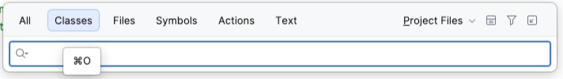

It’s now Week 3 of Recurse Center, and it’s been a whirlwind. From starting in-person at the Hub in Brooklyn, to now back working remote, I’ve now experienced RC from both sides of the screen. 

As someone who has worked remote now for 6 years (since the pandemic), I’ve become increasingly comfortable sharing my screen in absolutely any circumstance. I always appreciate when a colleague shares their screen so I can get an inside peak behind the curtain at how they think and work. 

Just like slides, reference docs, or AI tools, screen sharing is a learning device to: 

- Understand how someone works & reflect on your own style of working, and
- Communicate more efficiently.

**Understanding working styles**

When a colleague shares their screen, you get a peek into their setup, their environment. You’ll see what browser they use, their terminal is set up, and what IDE they have. But, even more importantly, you’ll see how they move about their computer. The different shortcuts they use, how they switch from screen to screen, and very importantly how many tabs to they have open at one time. This is the inside working of someone’s brain and will help you understand how they think and their working style. 

A few years ago, I was getting comfortable with IntelliJ and I saw my colleague pull up the IDE search bar with Command-O. This is now a shortcut I use daily. 

Some people are naturally curious and will do research to customize their setup and learn every shortcut, while others (like me) prefer the struggle of clicking through UI elements until one day they see a colleague use the shortcut that will make their life easier. 

Sharing your screen is a generous way to mentor and pass on knowledge to the next generation of computer savvy coders and tinkerers. 

**Communicating effectively**

This is the more obvious reason you may want to share your screen. Visualizations are an effective way to communicate ideas across, especially when working remotely. Whether sharing slides, a flow chart, shared notes, or your code base, a discussion will go smoother and quicker when you are sharing your screen, making the discussion accessible for all learning styles. 

This does not need to be formal. If you start talking about your code base, share you screen. If you are describing a flow chart or an image or place in the world, google it and share your screen. It’s almost certainly readily available. Sharing links as well gives your team a way to revisit those materials later, reinforcing the ideas. 

**Impromptu sharing**

Some of the best meetings and learning moments I’ve had are impromptu screen share moments. This week, we held the “Data Discussion Crew” to discuss any topics in data. The conversation led to Airflow and we had an impromptu review of the docs and code-sharing workshop. Being able to review the docs together and navigate a codebase from the eyes of someone who has worked on it helped reduce the barriers for the new folks to the tool. 

Next time your having a hard time communicating in a meeting. Or, you don’t know where to start with a topic. Just share your screen. The conversation and learning will flow.